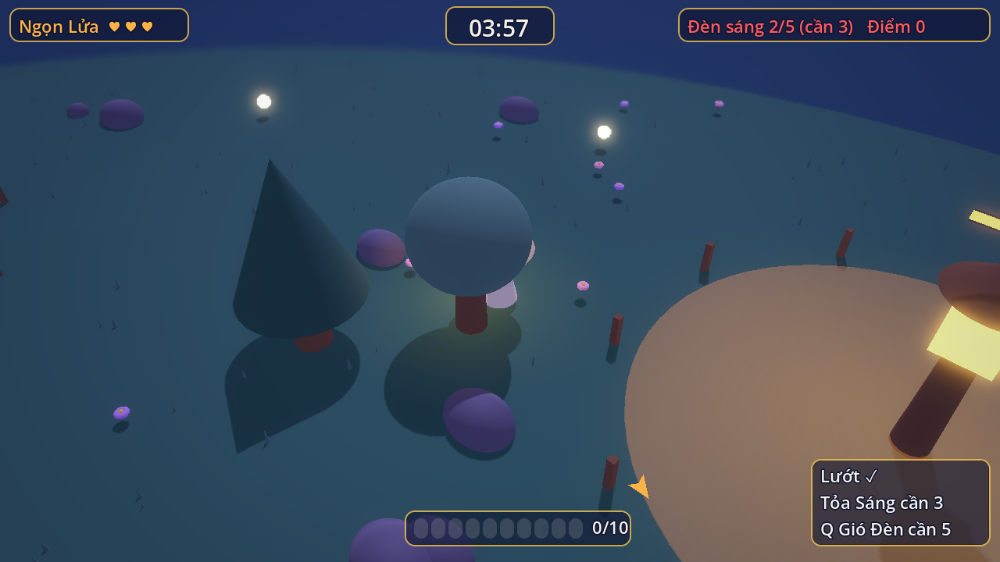

# Đảo Đèn Lồng (Day 12 · AI SDLC)

> **Video demo:** [Release v1.0.0](https://github.com/Hung-341/K5-L3A-DAY12-LeGiaHung-2A202603706-AI-SDLC-Dao-Den-Long/releases/tag/v1.0.0) (`demo.mp4`) · **Bản chạy được:** cùng trang Release · Tài liệu lab gốc: [LAB-README.md](LAB-README.md)



Game 3D góc nhìn thứ ba làm bằng Godot 4.7.2. Mây đội nón lá treo đèn lồng nhỏ, nhặt đom đóm trên ba hòn đảo trôi giữa biển mây để thắp và giữ dầu cho các Đèn Lồng Lớn, né Bóng Mực, Gió Lạc và Sương Gai, và **giữ đảo sáng tới bình minh**.

## Yêu cầu hệ thống
- **Chơi:** macOS 12+ hoặc Linux x86_64/arm64 (có X11/Wayland), GPU hỗ trợ Vulkan hoặc Metal, `curl` và `unzip`. `run.sh` tự tải Godot 4.7.2 chính thức (khoảng 60 MB, một lần) nếu máy chưa có. Windows: dùng bản Windows trong Release.
- **Headless / soak:** Godot 4 trên PATH, hoặc Docker (dùng `docker build` bên dưới).
- **Test:** Python 3.8+ (chỉ dùng thư viện chuẩn).

## Cài và chơi (3 lệnh)

```bash
git clone https://github.com/Hung-341/K5-L3A-DAY12-LeGiaHung-2A202603706-AI-SDLC-Dao-Den-Long.git
cd K5-L3A-DAY12-LeGiaHung-2A202603706-AI-SDLC-Dao-Den-Long
./run.sh
```

## Lệnh theo Test Contract v1.3 ([game.contract.json](game.contract.json))

| Việc | Lệnh |
|---|---|
| build_cmd (image headless) | `docker build -t dao-den-long .` |
| run_cmd (chơi) | `./run.sh` |
| headless_cmd | `./headless.sh --seed 1 --night 1 --ticks 600 --out out/a.jsonl [--scenario f.json] [--inputs f.json]` |
| bench_cmd | `./bench.sh --seed 42 --duration 30 --out bench.json` (cần màn hình; tắt vsync) |
| soak_cmd | `./headless.sh --soak --seed 7 --nights 10 --out soak.json` |
| Xuất bảng xếp hạng | `./run.sh --export-leaderboard out.json` |
| Test | `python3 tests/run_tests.py` (78 scenario headless) |

`headless.sh` dùng Godot 4 có sẵn (biến `GODOT` hoặc `godot` trên PATH), nếu không thì chạy trong Docker image `dao-den-long`. Kết quả tự đo nằm ở [docs/proof/phase4/](docs/proof/phase4/): bench avg **135.9 FPS**, p1_low **43.0**, load **2.75 s**; soak 10 Đêm **0 crash**.

## Điều khiển (đổi được trong Cài đặt → Đổi phím)

| Phím mặc định | Việc |
|---|---|
| W A S D | Đi theo hướng camera |
| Chuột / cuộn chuột | Xoay camera góc nhìn thứ ba / zoom |
| Space | Nhảy |
| Shift | Lướt |
| E | Nạp đom đóm vào đèn / châm dầu |
| F hoặc chuột trái | Tỏa Sáng (3 đom đóm) |
| Q | Gió Đèn: thổi bay Sương Gai (phần sáng tạo) |
| P hoặc Esc | Tạm dừng: Tiếp tục / Chơi lại Đêm / Cài đặt / Về menu |

**Cài đặt** (được lưu): âm lượng, độ nhạy chuột, bảng màu dễ phân biệt, giảm chuyển động, chữ lớn ×1.25, đổi phím (báo trùng, khôi phục mặc định), trang phục.

## Luật và cách tính điểm (v1.2–v1.3)
- **Ba Đêm:** Đảo Bến (5 đèn, 240 s), Đảo Cau (6 đèn, 270 s, cầu tre, bục nhảy), Đảo Chuông (7 đèn, 300 s, 3 tầng, dốc, gió mạnh).
- **Đom đóm:** nhặt tự động trong 1.0 m. Sức chứa `10 + 2 × số lần thắp thành công`, tối đa 20. Thắp đèn lần đầu cần 10, thắp lại cần 5.
- **Dầu đèn:** đèn sáng có 100 dầu, hao 1/s. E để châm (+10 dầu mỗi đom đóm). Đèn dưới 30 dầu nhấp nháy, mất vùng an toàn 6 m, và Bóng Mực tới hút 5/s. Hết dầu thì đèn tắt.
- **Kẻ địch:**
  - Bóng Mực đuổi khi trong 12 m, chạm thì −1 Ngọn Lửa (có 3). Tỏa Sáng làm choáng 2 s và đẩy 4 m.
  - Gió Lạc (Đêm 2–3) cướp 3 đom đóm khi Mây mang ≥ 5.
  - Rơi khỏi đảo: −1 Ngọn Lửa và mất hết đom đóm.
- **Thắng:** còn sống tới bình minh và có ≥ 60% đèn đang sáng (3/5, 4/6, 5/7). Thua thì chơi lại Đêm đó; thắng Đêm 3 thì ra màn Bình Minh và lưu điểm vào **Bảng xếp hạng** (top 10).
- **Điểm:** +5 mỗi đom đóm nạp vào đèn · +100 thắp lần đầu · +40 thắp lại · +5 mỗi Bóng Mực trúng Tỏa Sáng (+15 nếu nó đang hút dầu) · khi thắng: mỗi đèn sáng +50 + floor(dầu), mỗi Ngọn Lửa +50. Tổng điểm là tổng các Đêm đã thắng.
- `fall_enabled: true`. Không có khái niệm nào để `null`.

## Tài liệu
[CHANGELOG.md](CHANGELOG.md) (4 phase, breaking changes) · [ADR 0001](docs/adr/0001-lantern-fuel-and-dawn-win.md) · ghi chép từng phase [docs/notes/](docs/notes/) · bằng chứng [docs/proof/](docs/proof/) · [retro](docs/notes/retro.md) · [kịch bản demo](docs/demo/DEMO-SCRIPT.md) · [CREDITS.md](CREDITS.md) · [LICENSE](LICENSE).

## Sáng tạo của tôi

Phần thêm chia hai loại. Cả hai đều không đổi luật hay số liệu chuẩn.

**A. Chỉ có trong bản giao diện** (`scripts/view.gd`, `scripts/creative.gd`; headless không nạp hai file này, nên output contract không đổi):
- **Sương Gai:** kẻ địch mới (ticket cho phép thêm kẻ địch ngoài Bóng Mực và Gió Lạc). Mỗi 4 đom đóm Mây đang mang thu hút thêm 1 Sương Gai, tối đa 5. Chúng tới từ hướng bất kỳ, nhanh 4.5 m/s, chạm thì cướp 1 đom đóm và **không trừ Ngọn Lửa**. Người chơi phải chọn: ôm nhiều để thắp và châm dầu nhanh, hay nạp sớm cho an toàn.
- **Gió Đèn (Q):** tốn 5 đom đóm, thổi bay Sương Gai trong 9 m, hồi 4 s. Không tác động Bóng Mực, vì luật chuẩn quy định Bóng Mực chỉ bị Tỏa Sáng đẩy và không chết.
- **Phản đòn và phần thưởng:** lướt xuyên qua Sương Gai sẽ hất văng nó; đáp từ trên xuống đầu Sương Gai sẽ đạp vỡ nó (Mây không nảy thêm, luật nhảy giữ nguyên). Mỗi lần thắp đèn thành công: Gió Đèn rẻ hơn 1 đom đóm (tối thiểu 2), rộng thêm 2 m, và Sương Gai cần thêm 1 đom đóm mới bị thu hút. Không cộng thời gian, không tăng tầm lướt hay nhảy, vì đó là số liệu chuẩn.
- **Viền tối:** mang càng nhiều đom đóm, rìa màn hình càng tối. Ánh sáng môi trường chuẩn (`0.15 + 0.55 × đèn sáng/tổng`) giữ nguyên.
- **Đảo "đồ chơi trong mơ":** nhân vật chibi, tilt-shift; cây, đá, cỏ, hoa (có cuống và cánh, không phát sáng để không nhầm với đom đóm); hàng rào gỗ đánh dấu vùng an toàn 6 m. Trang trí **không có va chạm** và được đặt tránh đèn, điểm đom đóm, bục nhảy, để không đổi bản đồ chuẩn.
- **Cảm giác điều khiển:** nội suy hình giữa các tick, camera góc nhìn thứ ba xoay tự do (chuột ngang/dọc, cuộn để zoom, không xuyên đất), nhớ phím 0.1 s. Bóng Mực để lại vệt mực khi đuổi; tốc độ thật vẫn là 4.0 m/s.
- Âm thanh tổng hợp bằng code (`scripts/sfx.gd`), không dùng file âm thanh ngoài.
- **Chọn Đêm** trong menu: chơi thẳng một Đêm bất kỳ, chuỗi giới thiệu → chơi → kết quả → Đêm kế giữ nguyên.
- **Trang phục:** chọn phụ kiện (hoa cài nón, đèn cá chép, ba lô lá), được lưu lại. Áo `#E8E2D0`, khăn `#C8102E`, nón lá và đèn lồng nhỏ giữ đúng PRD và bảng màu.
- **Đom đóm bay quanh Mây:** mang bao nhiêu thì có bấy nhiêu con bay quanh người. Thanh 10 ô và "đang mang / sức chứa" trên HUD vẫn giữ vì là yêu cầu bắt buộc.

**B. Lựa chọn thiết kế trong khuôn luật** (trong `sim.gd`, có test):
- Đom đóm sinh ở **điểm trống xa Mây nhất**: ticket chỉ nói "một điểm trống". Xem `test_mote_spawn_farthest_free_point`.
- Bóng Mực lang thang theo **4 tính cách** theo id: bám đuôi ở 14 m, tuần tra mép đảo, rình quanh đèn, đi ngẫu nhiên. Tốc độ ≤ 4.0 m/s; luật đuổi, hút dầu, gây hit giữ nguyên. Xem `test_wander_personalities_speed_capped`.

Bằng chứng phần cũ vẫn đúng: toàn bộ test headless vẫn đạt ([docs/proof/](docs/proof/)).

## Harness AI

[AGENTS.md](AGENTS.md) (cập nhật qua 4 phase) · skill [verify-game](.claude/skills/verify-game/SKILL.md) · hook Stop chặn kết thúc khi test đỏ ([.claude/settings.json](.claude/settings.json)) · CI chạy test mỗi lần push ([.github/workflows/test.yml](.github/workflows/test.yml)) · công cụ chụp ảnh bằng chứng `DDL_SHOT`.
